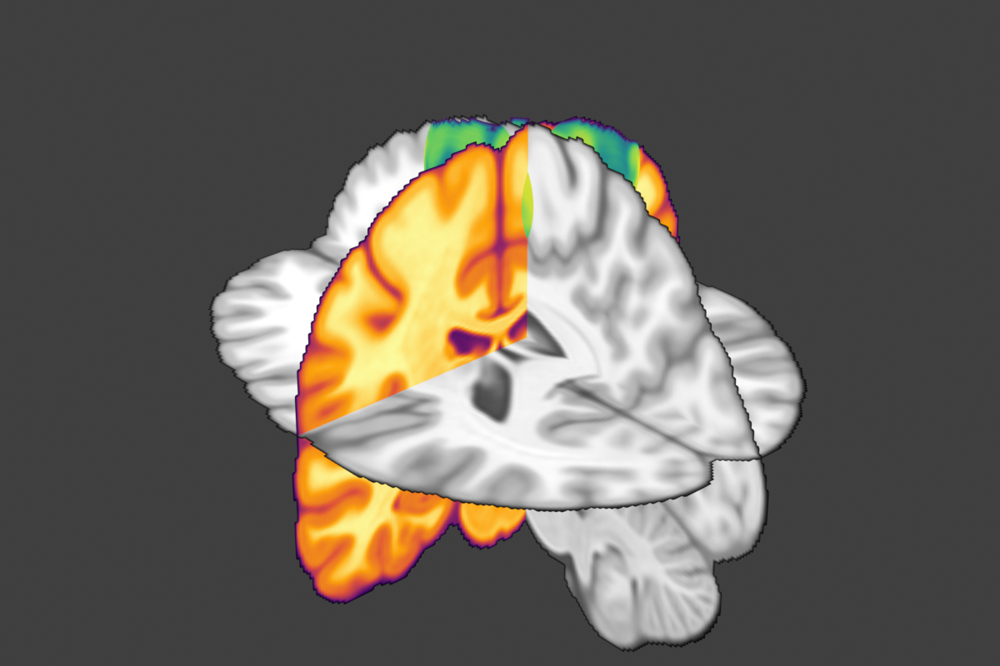

# BrainBlend

A Blender extension to display MRI volumes (NIfTI) on any surface of a scene.



An imported volume is placed in world space using the image affine
(millimetres, RAS) and shown as a wire bounding box. A *slice material* samples
the voxels at the position of each shading point, maps the values through a
window and a color map, and is transparent outside the volume. Any mesh using
this material (a plane, a curved surface, a sphere...) shows the matching cut
through the volume, and the image updates live when the mesh is moved, in the
viewport (Material Preview) as well as in renders (EEVEE and Cycles).

## Installation

1. Download `brainblend-<version>.zip` (artifact of the CI workflow, or build it
   with `python tools/build.py`).
2. In Blender (4.2 or later, tested with 5.3): *Edit > Preferences > Get
   Extensions*, menu *v* at the top right, *Install from Disk...*, pick the zip.

The zip bundles [nibabel](https://nipy.org/nibabel/) as a wheel; numpy comes
with Blender.

## Usage

* *File > Import > NIfTI volume*, or the **BrainBlend** tab of the 3D view
  sidebar (`N`). By default axial, coronal and sagittal planes are added
  through the centre of the volume. Several files can be imported at once;
  volumes in the same scanner/template space overlay correctly.
* Switch the viewport to **Material Preview** to see the slices.
* Move, rotate or deform the planes: the slice follows. Moving the volume box
  moves the image.
* *Add slice plane* adds more planes; *Show Volume on Selected* gives a slice
  material of the active volume to any selected mesh.
* With a slice object active, the *Slice Display* panel sets the window
  (min/max, auto or full range), the color map (gray, hot, inferno, viridis,
  jet, cool-warm, red/green/blue, or a freely edited ramp), the opacity and
  *Transparent below min* (useful to overlay a map on an anatomy).
* *Interpolation* (per volume): trilinear (smooth) or nearest (voxel blocks).
* *Scale (units per mm)*: Blender units per millimetre used at import. The
  default 0.001 keeps the real size in metres.

The import switches color management to the *Standard* view transform so that
displayed colors match the color map (option of the import operator).

## How it works

Blender shader nodes cannot sample 3D textures, so the volume is stored in a
2D float image (packed in the .blend file): 4 consecutive slices go in the R,
G, B, A channels of one tile and tiles are arranged on a grid
(`brainblend/atlas.py`). For each volume, a node group (`BB Sampler <name>`)
uses a *Texture Coordinate* node referencing the volume object to get the
shading point in the volume's space, converts it to voxel indices, and reads
the voxels with exact (*Closest*) image lookups, doing the trilinear
interpolation itself.

The volume object only holds the rotation and translation of the affine;
scaling, flips and shear are applied in the shader, so oblique and sheared
affines are supported.

A 512×512×300 volume needs a 4608×4608 float image (about 340 MB of GPU
memory); the GPU texture limit (16384 pixels) is reached around 1024×1024×256.

## Development

```sh
pip install bpy==5.3.0 nibabel pytest   # Blender as a Python module (Python 3.13)
python -m pytest tests                   # renders slices with Cycles, compares with numpy
BB_TEST_EEVEE=1 python -m pytest tests   # also with EEVEE (needs OpenGL/EGL)
python tools/build.py                    # dist/brainblend-<version>.zip
```

## Roadmap

* DICOM series import (pydicom).
* Lit (non-emissive) slice shading option, multi-volume blending in one material.
